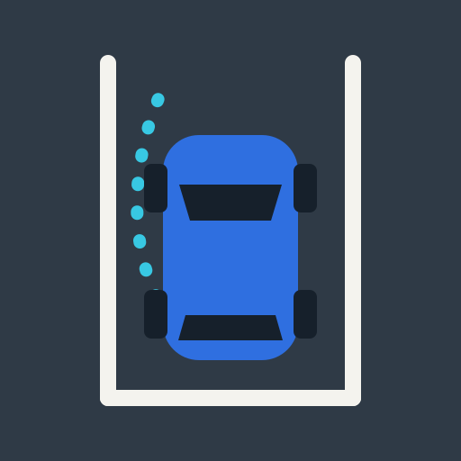

# Drive Practice

A calm driving practice game for iPad. It teaches how a car really moves in tight spaces: only the front wheels steer, the car pivots around the back axle, the back wheels cut inside the front ones, and when reversing the back of the car goes where you turn the wheel.

You steer with a large on-screen wheel (about 1.5 turns lock to lock), pick P, R or D, and use the gas and brake pedals with your other hand. Guide lines show where each wheel and the swinging front corner will go, a marker shows the point the car turns around, and a fading trail shows where the wheels actually went.

22 short levels in five chapters build up from driving in a straight line to parallel parking, a three-point turn, an underground garage and a car park ramp. A short animated lesson before the turning chapter shows why the back of the car cuts inside a corner. Progress and stars are saved on the device.

The game speaks English, Spanish, German, Polish and Chinese (Simplified). It picks the browser language and can be switched on the home screen.

## Play it

Live at **https://blazejkustra.github.io/drive-learning/**

On the iPad:

1. Open the link above in Safari.
2. Tap Share, then **Add to Home Screen**.
3. Open Drive Practice from the home screen. It runs full screen in landscape like an app.

## Install on iPhone/iPad

On a Mac with Xcode:

```sh
git clone https://github.com/blazejkustra/drive-learning.git
cd drive-learning
npm install
npm run ios
```

Xcode opens the project. Select the App target, open **Signing & Capabilities** and pick your team (a free Apple ID works). Plug in the iPhone or iPad, choose it as the run destination and press **Run**. Apps signed with a free account stop opening after 7 days; run again from Xcode to renew. A paid Apple Developer account removes that limit and allows TestFlight.

`npm run ios:build` builds for the simulator without signing, as a quick check.

## Run it locally

```sh
npm install
npm run dev
```

`npm run dev` starts Vite with `--host`, so the iPad can open it over the local network. Vite prints a `Network:` address such as `http://192.168.1.20:5173`; open that in Safari on the iPad (both devices on the same Wi-Fi).

## Build and deploy

```sh
npm run build
npm run preview
```

`npm run build` type-checks and writes a static site to `dist/`, and `npm run preview` serves that build over the network for a final check. Every push to `main` builds and publishes the site to GitHub Pages through `.github/workflows/deploy.yml`.

## Code layout

- `src/physics.ts`: kinematic bicycle model, car dimensions, speed and creep behaviour
- `src/game.ts`: a level session with collisions, touches, target and stars
- `src/guides.ts`, `src/trail.ts`: predicted wheel paths and the wheel trail
- `src/levels.ts`: all levels as data, built with helpers from `src/map-builder.ts`
- `src/render/`: canvas drawing for the map, cars and teaching overlays
- `src/input/`: steering wheel, pedals and gear selector
- `src/ui/`: home screen, play screen and the turning lesson
- `src/i18n/`: all text, one file per language; `en.ts` defines the keys the others must match

To add a level, add an entry to a chapter in `src/levels.ts` and its title, goal and tips under `levels` in every file in `src/i18n/`. Coordinates are in metres with y pointing down; headings are in degrees (0 east, 90 south, -90 north). `npm run check-levels` runs a small path planner over every level to confirm each one can be solved without touching anything.
